<a href="https://kdjadeja.vercel.app"><picture><source media="(prefers-color-scheme: dark) and (max-width: 600px)" srcset="assets/hero-phone-dark.svg"><source media="(max-width: 600px)" srcset="assets/hero-phone-light.svg"><source media="(prefers-color-scheme: dark)" srcset="assets/hero-dark.svg">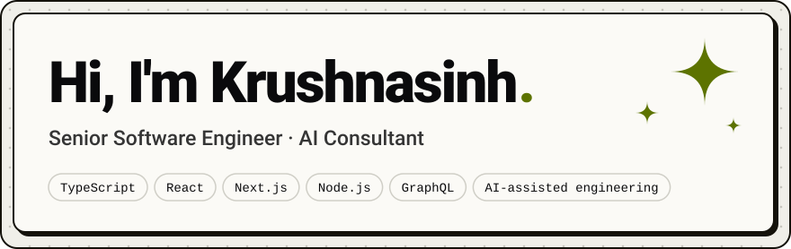</picture></a>

<a href="https://kdjadeja.vercel.app"><picture><source media="(prefers-color-scheme: dark) and (max-width: 600px)" srcset="assets/badge-site-phone-dark.svg"><source media="(max-width: 600px)" srcset="assets/badge-site-phone-light.svg"><source media="(prefers-color-scheme: dark)" srcset="assets/badge-site-dark.svg"></picture></a>
<a href="https://cursor.com/@kdjadeja"><picture><source media="(prefers-color-scheme: dark) and (max-width: 600px)" srcset="assets/badge-cursor-phone-dark.svg"><source media="(max-width: 600px)" srcset="assets/badge-cursor-phone-light.svg"><source media="(prefers-color-scheme: dark)" srcset="assets/badge-cursor-dark.svg"></picture></a>
<a href="mailto:kdjadeja209@gmail.com"><picture><source media="(prefers-color-scheme: dark) and (max-width: 600px)" srcset="assets/badge-email-phone-dark.svg"><source media="(max-width: 600px)" srcset="assets/badge-email-phone-light.svg"><source media="(prefers-color-scheme: dark)" srcset="assets/badge-email-dark.svg"></picture></a>

<!--stats:github-->
<picture><source media="(prefers-color-scheme: dark) and (max-width: 600px)" srcset="assets/github-phone-dark.svg"><source media="(max-width: 600px)" srcset="assets/github-phone-light.svg"><source media="(prefers-color-scheme: dark)" srcset="assets/github-dark.svg">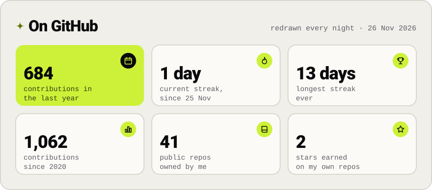</picture>
<!--/stats:github-->

<!--stats:graph-6m-->
<picture><source media="(prefers-color-scheme: dark) and (max-width: 600px)" srcset="assets/graph-6m-phone-dark.svg"><source media="(max-width: 600px)" srcset="assets/graph-6m-phone-light.svg"><source media="(prefers-color-scheme: dark)" srcset="assets/graph-6m-dark.svg">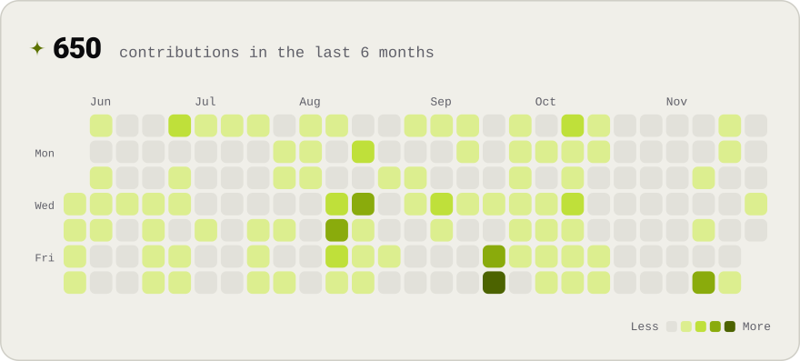</picture>
<!--/stats:graph-6m-->

<!--stats:years-->

Last 12 months: 685 contributions

<picture><source media="(prefers-color-scheme: dark) and (max-width: 600px)" srcset="assets/graph-12m-phone-dark.svg"><source media="(max-width: 600px)" srcset="assets/graph-12m-phone-light.svg"><source media="(prefers-color-scheme: dark)" srcset="assets/graph-12m-dark.svg">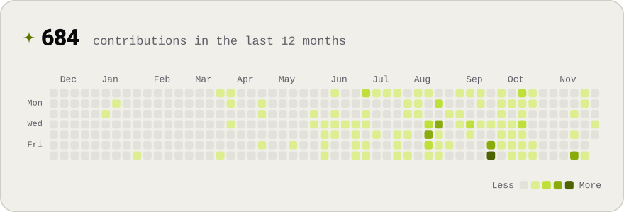</picture>

2026: 683 contributions

<picture><source media="(prefers-color-scheme: dark) and (max-width: 600px)" srcset="assets/graph-2026-phone-dark.svg"><source media="(max-width: 600px)" srcset="assets/graph-2026-phone-light.svg"><source media="(prefers-color-scheme: dark)" srcset="assets/graph-2026-dark.svg">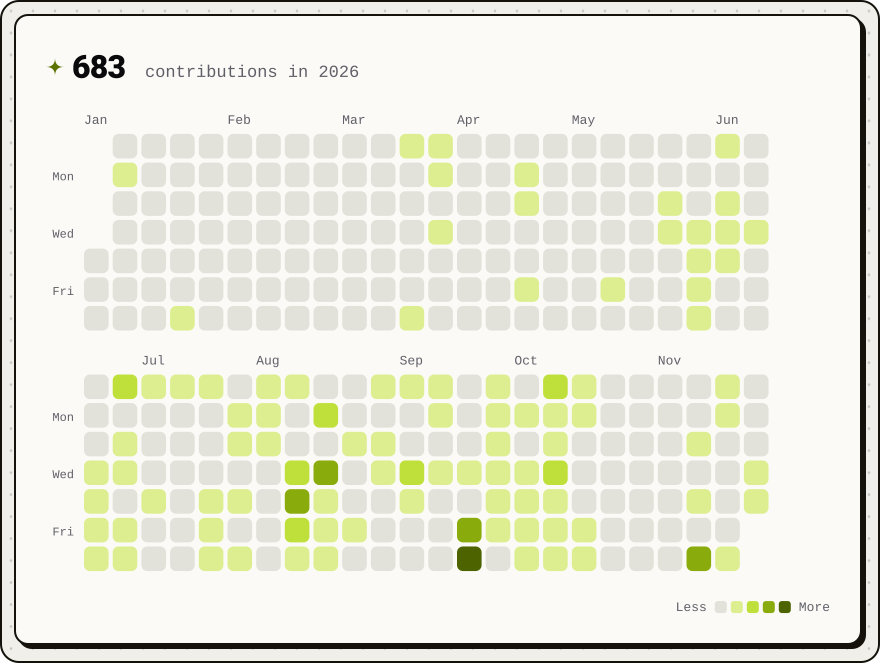</picture>

2025: 148 contributions

<picture><source media="(prefers-color-scheme: dark) and (max-width: 600px)" srcset="assets/graph-2025-phone-dark.svg"><source media="(max-width: 600px)" srcset="assets/graph-2025-phone-light.svg"><source media="(prefers-color-scheme: dark)" srcset="assets/graph-2025-dark.svg">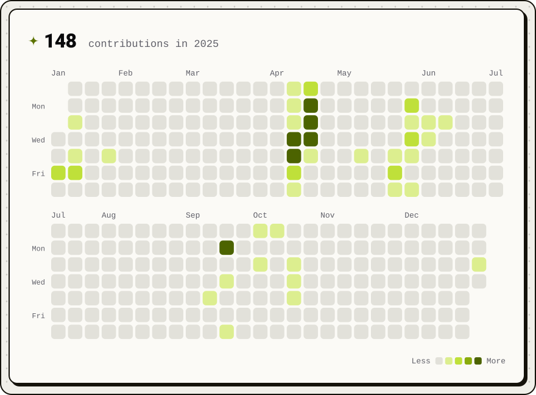</picture>

2024: 161 contributions

<picture><source media="(prefers-color-scheme: dark) and (max-width: 600px)" srcset="assets/graph-2024-phone-dark.svg"><source media="(max-width: 600px)" srcset="assets/graph-2024-phone-light.svg"><source media="(prefers-color-scheme: dark)" srcset="assets/graph-2024-dark.svg">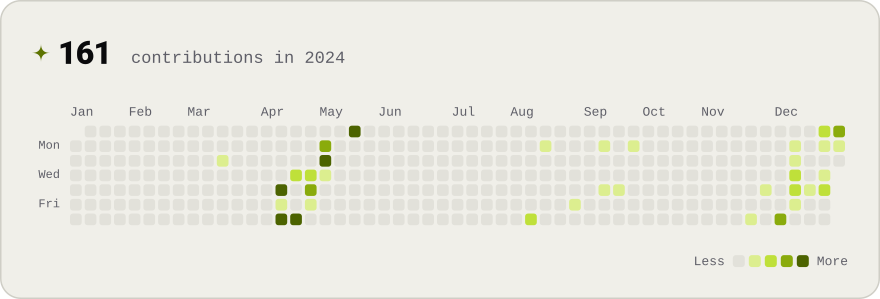</picture>

2023: 41 contributions

<picture><source media="(prefers-color-scheme: dark) and (max-width: 600px)" srcset="assets/graph-2023-phone-dark.svg"><source media="(max-width: 600px)" srcset="assets/graph-2023-phone-light.svg"><source media="(prefers-color-scheme: dark)" srcset="assets/graph-2023-dark.svg">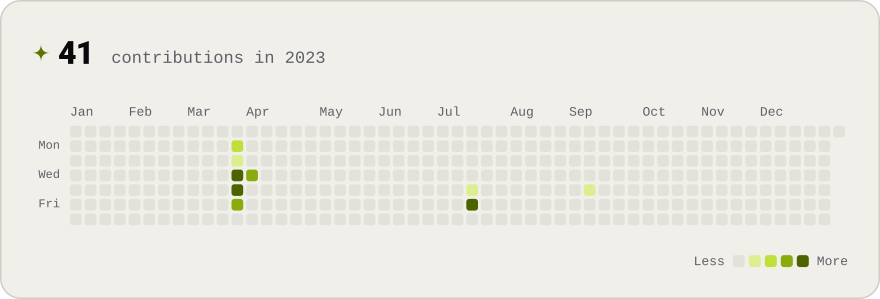</picture>

2022: 0 contributions

<picture><source media="(prefers-color-scheme: dark) and (max-width: 600px)" srcset="assets/graph-2022-phone-dark.svg"><source media="(max-width: 600px)" srcset="assets/graph-2022-phone-light.svg"><source media="(prefers-color-scheme: dark)" srcset="assets/graph-2022-dark.svg">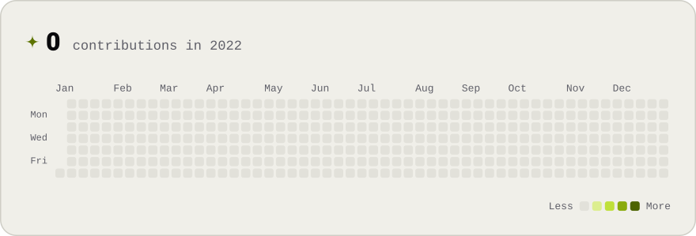</picture>

2021: 5 contributions

<picture><source media="(prefers-color-scheme: dark) and (max-width: 600px)" srcset="assets/graph-2021-phone-dark.svg"><source media="(max-width: 600px)" srcset="assets/graph-2021-phone-light.svg"><source media="(prefers-color-scheme: dark)" srcset="assets/graph-2021-dark.svg">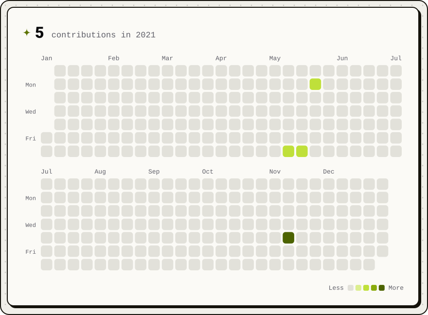</picture>

2020: 25 contributions

<picture><source media="(prefers-color-scheme: dark) and (max-width: 600px)" srcset="assets/graph-2020-phone-dark.svg"><source media="(max-width: 600px)" srcset="assets/graph-2020-phone-light.svg"><source media="(prefers-color-scheme: dark)" srcset="assets/graph-2020-dark.svg">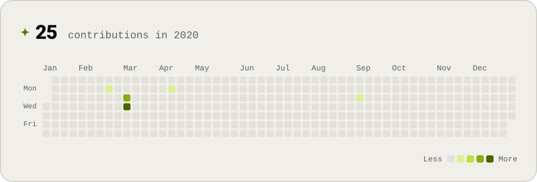</picture>

<!--/stats:years-->

<!--stats:line-30d-->
<picture><source media="(prefers-color-scheme: dark) and (max-width: 600px)" srcset="assets/line-30d-phone-dark.svg"><source media="(max-width: 600px)" srcset="assets/line-30d-phone-light.svg"><source media="(prefers-color-scheme: dark)" srcset="assets/line-30d-dark.svg">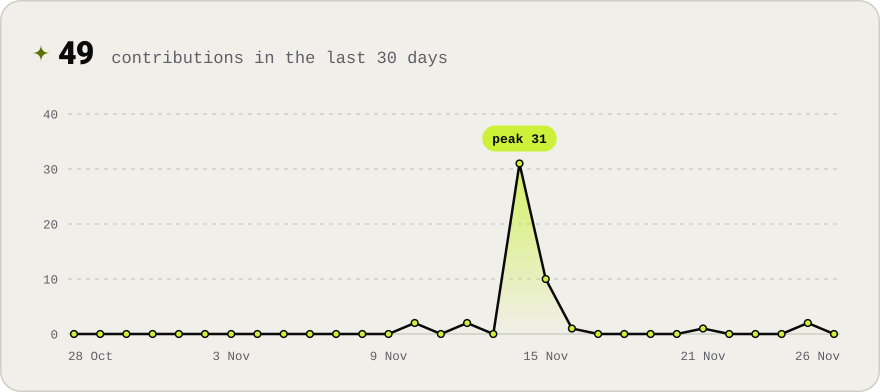</picture>
<!--/stats:line-30d-->

<picture><source media="(prefers-color-scheme: dark) and (max-width: 600px)" srcset="assets/whoami-phone-dark.svg"><source media="(max-width: 600px)" srcset="assets/whoami-phone-light.svg"><source media="(prefers-color-scheme: dark)" srcset="assets/whoami-dark.svg">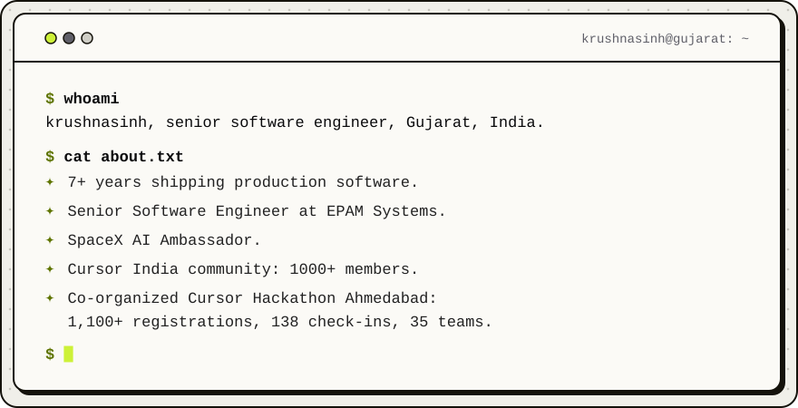</picture>

<picture><source media="(prefers-color-scheme: dark) and (max-width: 600px)" srcset="assets/label-ship-phone-dark.svg"><source media="(max-width: 600px)" srcset="assets/label-ship-phone-light.svg"><source media="(prefers-color-scheme: dark)" srcset="assets/label-ship-dark.svg"></picture>

<a href="https://blinqplay.com"><picture><source media="(prefers-color-scheme: dark) and (max-width: 600px)" srcset="assets/app-blinq-phone-dark.svg"><source media="(max-width: 600px)" srcset="assets/app-blinq-phone-light.svg"><source media="(prefers-color-scheme: dark)" srcset="assets/app-blinq-dark.svg">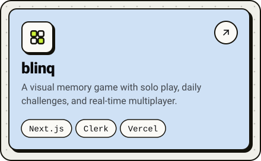</picture></a>
<a href="https://eventclaim.vercel.app"><picture><source media="(prefers-color-scheme: dark) and (max-width: 600px)" srcset="assets/app-eventclaim-phone-dark.svg"><source media="(max-width: 600px)" srcset="assets/app-eventclaim-phone-light.svg"><source media="(prefers-color-scheme: dark)" srcset="assets/app-eventclaim-dark.svg">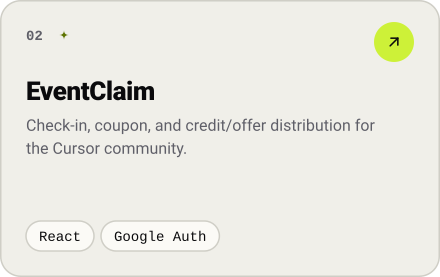</picture></a>
<a href="https://github.com/kdjadeja21/product-demo-video-agent-plugin"><picture><source media="(prefers-color-scheme: dark) and (max-width: 600px)" srcset="assets/app-demo-video-plugin-phone-dark.svg"><source media="(max-width: 600px)" srcset="assets/app-demo-video-plugin-phone-light.svg"><source media="(prefers-color-scheme: dark)" srcset="assets/app-demo-video-plugin-dark.svg">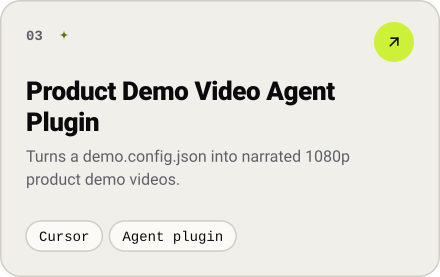</picture></a>
<a href="https://inhandsalary.vercel.app"><picture><source media="(prefers-color-scheme: dark) and (max-width: 600px)" srcset="assets/app-in-hand-helper-phone-dark.svg"><source media="(max-width: 600px)" srcset="assets/app-in-hand-helper-phone-light.svg"><source media="(prefers-color-scheme: dark)" srcset="assets/app-in-hand-helper-dark.svg">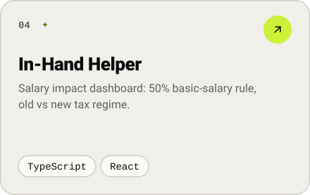</picture></a>

more ships: <a href="https://backdrop-studio.vercel.app">Backdrop Studio</a> · <a href="https://sip-calc.vercel.app">SIP Calculator</a> · <a href="https://github.com/kdjadeja21/router-pulse">Router Pulse</a>

numbers redrawn every night by a GitHub Action · <a href="https://kdjadeja.vercel.app">kdjadeja.vercel.app</a>

